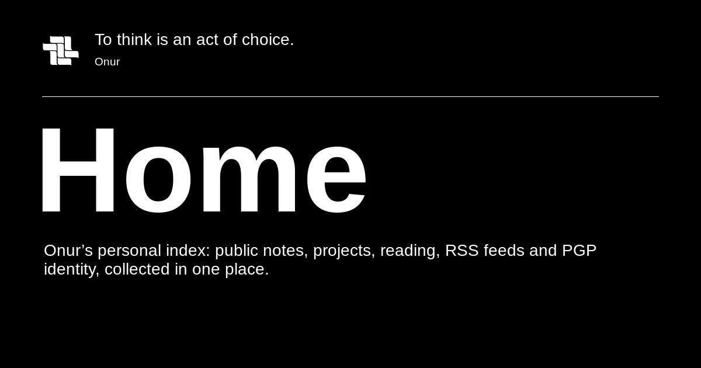

<div align="center">

<a href="https://portfolio-seven-plum-73.vercel.app/">
  
</a>

<p>
  <a href="https://portfolio-seven-plum-73.vercel.app/">Website</a> ⁜
  <a href="https://portfolio-seven-plum-73.vercel.app/log">Logs</a> ⁜
  <a href="https://portfolio-seven-plum-73.vercel.app/pgp">PGP</a> ⁜
  <a href="https://portfolio-seven-plum-73.vercel.app/rss">RSS</a>
</p>

<p>
  <a href="https://github.com/OnurByte/onur.af/actions/workflows/ci.yml"></a>
  <a href="https://github.com/OnurByte/onur.af/actions/workflows/quality.yml"></a>
</p>

</div>

# Onur

I am. I think. I will.

My place for code, Logs and things worth verifying. The interface is monochrome and follows the system theme. Sources, revisions and evidence stay visible.


## Explore

- **[Logs](https://portfolio-seven-plum-73.vercel.app/log):** Writing with revision histories, sources and portable proof archives.
- **[PGP](https://portfolio-seven-plum-73.vercel.app/pgp):** Public keys and signature verification.
- **[RSS](https://portfolio-seven-plum-73.vercel.app/rss):** Subscribe to new Logs without a platform account.
- **Activity:** GitHub projects, Tweets and music, presented in the site's own interface.
- **[Contribute](https://portfolio-seven-plum-73.vercel.app/contribute):** Optional Monero support. Payment functions require a separately configured local gateway.

## Run locally

Requires Node 24 and Bun 1.4.x.

```sh
bun install --frozen-lockfile
bun run dev
```

Copy `.env.example` to `.env` only for optional services. The site can render without a wallet or payment gateway.

## Check

```sh
bun run verify
bun run test:browser
```

`verify` runs formatting, lint, type and architecture checks, a build and unit tests. Browser tests require a current build and installed Playwright browsers. Payment tests use a synthetic gateway, not a real wallet.

## Under the hood

Astro, TypeScript, StyleX and Bun. PostgreSQL and a view-only Monero wallet agent support optional contribution services.

- [Development and deployment](docs/development.md)
- [Design and brand](brand.md)
- [Signed Logs and portable proofs](docs/portable-log-proofs.md)
- [Contributions and trust boundaries](docs/donations.md)
- [Verification gates](docs/acceptance.md)

Publishing, signing, wallet operations and deployment are separate owner actions. The web server and CI do not need PGP private keys. Signatures prove bytes and key relationships, not the truth of a claim or the safety of software. Visitor analytics is off by default.

## A Cypherpunk's Manifesto

*Eric Hughes ⁜ 9 March 1993*

> Privacy is necessary for an open society in the electronic age. Privacy is not secrecy.

[Read the complete manifesto](https://github.com/NakamotoInstitute/nakamotoinstitute.org/blob/35fca1136a24262b4a36e4a32417c712837da304/server/content/library/cypherpunk-manifesto.en.md).
