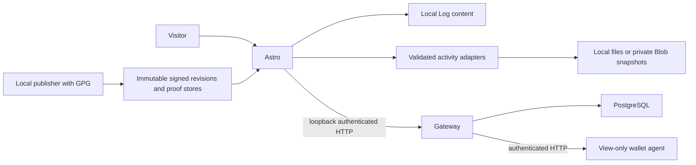

# Development and operational boundaries

The portfolio uses server-rendered Astro with compiled StyleX. Node's standalone adapter is the local/default production target; Vercel builds use its adapter. `SITE_URL` supplies the canonical public origin. Local `.env` is ignored by Git. Do not put wallet secrets in content or public variables.

`src/client/` contains browser modules. `src/server/` owns server helpers; payment logic lives in `src/donations/`, the HTTP gateway in `src/gateway.ts`, and wallet hosting in `src/xmr/`. The dependency-cruiser gate rejects browser access to server/payment code and transitive Node dependencies. This graph currently inspects TypeScript, not inline Astro scripts or vendor implementations.

## Setup and checks

Use `bun install --frozen-lockfile`, then `bun run dev`. `bun run lint` and `bun run type-coverage:check` prepare generated Astro types themselves. `bun run verify` is the complete local static/build/unit gate. A passing local gate is not a GitHub run, browser observation, live payment or production cost measurement.

`bun run build` verifies signed content and offline timestamp digest bindings before generating the independent proof verifier and Astro output. It does not regenerate signatures. Missing signing artifacts fail intentionally. `bun run start` launches the built Node server; `bun run gateway` and `bun run agent` start separate payment processes and require explicit local configuration.

Browser tests use `tests/browser/server.ts` and a synthetic gateway bound to loopback. Optional database tests require an isolated `TEST_DATABASE_URL`. Never point tests at a live payment database. Read [acceptance.md](acceptance.md) before operating payment infrastructure.

## Storage and external sources

Activity adapters return normalized data only. GitShow/FxTwitter/Lanyard are optional data sources, not proof of ownership or availability. File snapshots use `PORTFOLIO_EMBED_CACHE_DIR` or local `data/embeds`; Vercel uses private Blob when configured. Last successful data can be stale. Cache corruption and unavailable storage must not produce invented content or erase valid upstream data.

Log content remains local. The home streams primary content before optional activity finishes. Do not mark the whole dynamic home publicly cacheable merely to improve a score: random motto, source health and canonical metadata have different freshness needs.

## Security and publication

Use [key history](key-history.md), [portable proofs](portable-log-proofs.md) and [integrated publication](integrated-publication.md) for exact signing/publishing semantics. A local build needs public verification material; only the local publisher needs a private signing key. Timestamp digest verification is separate from independent Bitcoin confirmation.

Contribution amounts use exact piconero arithmetic. Allocation uncertainty, mismatched wallet identity and uncertain chain state fail closed. Fake-agent tests cannot prove real scanning, payment detection, reorg recovery or deployment safety. Configure production allowed domains, persistent wallet/ledger storage and backup/recovery before enabling real payments.

The repository preserves a counted ESLint debt baseline. Fix real unsafe paths then prune resolved entries; do not add suppressions to hide an environmental type-generation error. Dependency audits, inventories and tool-generated evidence establish only the scope they actually inspect.

## Build evidence and architecture

`bun run evidence:build` derives a bounded module graph from dependency-cruiser and publishes `/build-evidence.json`. The manifest records the shared portfolio and Log dependency graph; it has no separate article catalog or browser disclosure. Local modifications are labeled explicitly. The base commit link may differ from dirty working files, so the manifest includes a source digest. A generated manifest with no observations must not claim tests passed.

`bun run evidence:verify` executes the real aggregate verification and records its actual exit code/start/end time for the source digest. CI records its individual checks and uploads the manifest as `build-evidence`. These are observations, not cryptographic attestations. A failed check stays failed. Changes to runtime source, tests, check/build configuration, patches, CI policy and public inputs invalidate previous receipts. Generated evidence, generated proof-verifier code, derived log-media, local secrets and documentation-only edits are excluded from the digest to avoid self-reference and private inputs. Deploy only the manifest generated for the same source as the deployment.

`bun run dependencies:inventory` emits `.local/sbom.cdx.json` (CycloneDX 1.6) from exact Bun resolutions, including available integrity hashes. Scheduled dependency CI retains this plus `bun audit` JSON. The audit uploads its evidence before propagating advisory or tool failures to the job result; no advisory is ignored or claimed fixed merely by inventory generation. Wallet/OTS transitive upgrades need compatibility review.

## Optional performance observations

Performance collection is **off by default**. With `PORTFOLIO_VITALS_ENABLED=1`, the page enables Google's `web-vitals` LCP, INP and TTFB observers and sends only the metric name, numeric value and coarse page category to same-origin `/vitals.json`. Respect Do Not Track. No visitor ID, full URL/query, payment address, receipt ID, referrer or DOM attribution is sent. Contribution/private pages are excluded. The disabled receiver returns 404.

Enabled observations are emitted as `portfolio-vital` JSON in application logs, not a new third-party account or persistent database. Treat them as untrusted client observations; use exported logs to compute comparable distributions and retention policies appropriate to the deployment. A malicious client can forge performance values. The endpoint bounds JSON bodies and requires same-origin POST. Vercel's own hosting logs/retention are separate platform behavior.

Production p95 TTFB, LCP/INP distributions, external-request counts and billing require real deployment data. The connected metrics API returning an error is not a zero-cost or zero-latency result. No cache-policy claim should be based solely on local Lighthouse scores. Keep `no-store` on the random-motto/live-activity home until deployment measurements justify a different freshness contract.
